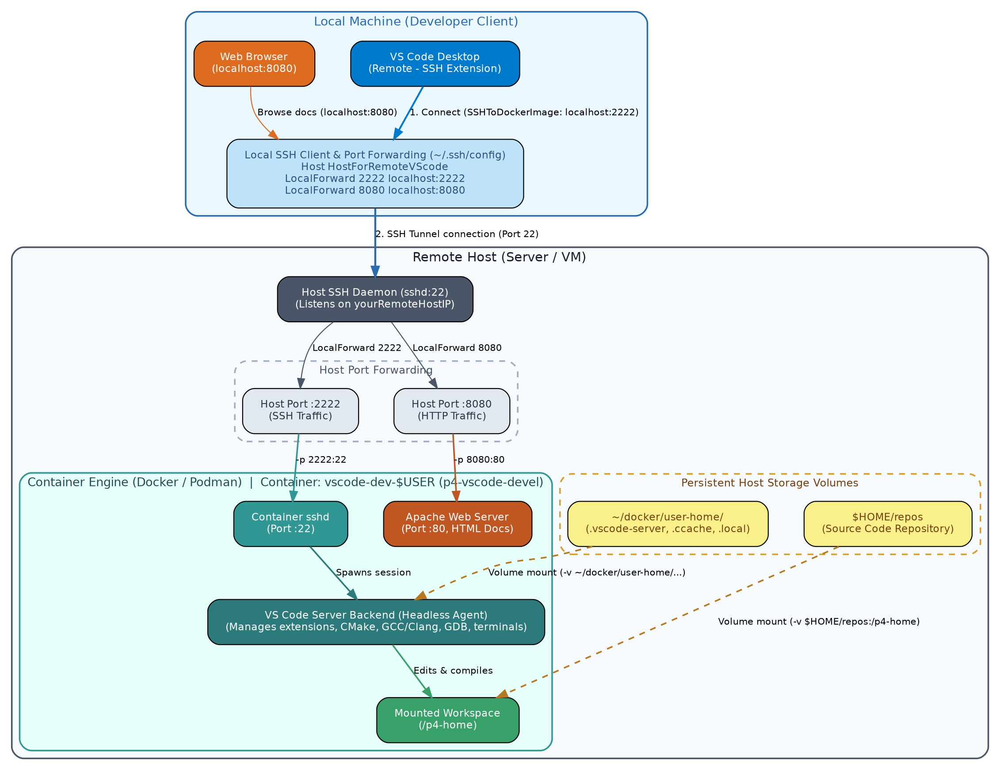
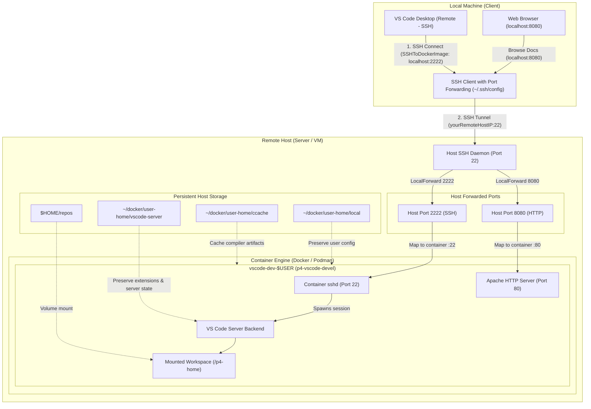

# Visual Studio Code Docker Environment

This guide explains how to set up a remote development environment using Docker (or Podman) and Visual Studio Code.
The development environment is based on freely available tools and supports standard Ubuntu 24.04, Debian stable, AlmaLinux 9, and AlmaLinux 8 base images.

**Required Tools**:

* **Local Machine**: [Visual Studio Code](https://code.visualstudio.com/), SSH in WSL or native SSH client
* **Remote Host**: Docker or Podman

---

## Architecture Overview

The setup runs a development container with an internal SSH daemon. Visual Studio Code on your local machine connects to the container using the official [Remote - SSH extension](https://code.visualstudio.com/docs/remote/ssh) over an SSH tunnel.





### Connection Flow

1. **Container Startup**: Docker or Podman runs the container image (`p4-vscode-devel`), starts the container's `sshd` on port 22 (mapped to host port `2222`), and mounts host repositories into `/p4-home`.
2. **SSH Tunneling**: A single SSH command (`ssh HostForRemoteVScode`) tunnels local port 2222 (for VS Code Remote-SSH) and port 8080 (for web documentation) from your local machine to the remote host.
3. **VS Code Remote-SSH**: In VS Code, connecting to `SSHToDockerImage` attaches directly into the container via `localhost:2222` using your SSH keys. VS Code runs its backend `vscode-server` directly inside the container.
4. **Isolated Development**: All compilers, tools (CMake, GCC/Clang, Python, LaTeX), and VS Code extensions run inside the container, while all workspace code and user cache persist on the host filesystem.

---

## Building the Image

Use `build-image.sh` to build the development image. The script automatically detects `docker` or `podman` and supports Ubuntu 24.04, Debian stable, AlmaLinux 9, and AlmaLinux 8:

```bash
# Build AlmaLinux 9 image (default: uses Dockerfile.alma9)
./build-image.sh

# Build AlmaLinux 9 explicitly
./build-image.sh -d Dockerfile.alma9

# Build Debian stable image (default mirror: deb.debian.org)
./build-image.sh -d Dockerfile.debian

# Build Debian stable using ČVUT or regional mirror:
./build-image.sh -d Dockerfile.debian -m cz

# Build Ubuntu 24.04 image (default mirror: archive.ubuntu.com)
./build-image.sh -d Dockerfile.ubuntu

# Build Ubuntu 24.04 using a regional or custom mirror:
./build-image.sh -d Dockerfile.ubuntu -m cz     # Czech Republic - ČVUT mirror (ftp.cvut.cz)
./build-image.sh -d Dockerfile.ubuntu -m cvut   # Same as above (ftp.cvut.cz)
./build-image.sh -d Dockerfile.ubuntu -m us     # United States / Americas (us.archive.ubuntu.com)
./build-image.sh -d Dockerfile.ubuntu -m il     # Israel / Middle East (il.archive.ubuntu.com)
./build-image.sh -d Dockerfile.ubuntu -m jp     # Japan / Asia-Pacific (jp.archive.ubuntu.com)
./build-image.sh -d Dockerfile.ubuntu -m de.archive.ubuntu.com  # Custom domain
./build-image.sh -d Dockerfile.ubuntu -m http://local-cache:3142/ubuntu/  # Custom URL (e.g. apt-cacher-ng)

# Build AlmaLinux 8 image
./build-image.sh -d Dockerfile.alma8
```

> [!TIP]
> * **Ubuntu & Debian**: Use `-m` / `--mirror` with `cz` / `cvut`, `us`, `il`, `jp`, or any custom domain / URL to download packages from the closest server. APT HTTP pipelining is also enabled for parallel downloads.
> * **AlmaLinux**: DNF automatically benchmarks and chooses the lowest-latency mirror via `fastestmirror` and downloads up to 10 packages in parallel.

The build script configures SSH within the container and imports `$HOME/.ssh/authorized_keys` from the host so you can connect seamlessly using your SSH key.

---

## Running the Container

An example startup script is provided at `examples/run-vscode-docker`:

```bash
#!/usr/bin/env bash
echo "Starting the VS Code docker image ..."
docker run \
--privileged \
--name vscode-dev-$USER \
--interactive --tty --rm \
-p 2222:22 \
-p 8080:80 \
--env="DISPLAY" \
--env "PS1=docker-\w\$ " \
--volume="$HOME/.Xauthority:/root/.Xauthority:rw" \
--volume=$HOME/repos:/p4-home \
--volume=$HOME/docker/user-home/ccache:/home/$USER/.ccache \
--volume=$HOME/docker/user-home/vscode-server:/home/$USER/.vscode-server \
--volume=$HOME/docker/user-home/local:/home/$USER/.local \
p4-vscode-devel
```

Ensure the host directories exist before starting the container:

```bash
mkdir -p ~/docker/user-home/ccache ~/docker/user-home/vscode-server ~/docker/user-home/local
```

Key paths:
* The host repository path is `$HOME/repos` (mounted to `/p4-home` in the container).
* The non-root user inside the container has passwordless `sudo` privileges (default password is `docker`).
* The script forwards container port 22 to host port 2222.

Verify that the SSH server is running:

```bash
ssh -p 2222 localhost
```

---

## Attaching to a Running Container

An attach script (`examples/attach-vscode-docker`) is provided to open an interactive bash shell in a running container via `docker exec`. It accepts an image name or container name as an argument:

```bash
# Attach to the default container (vscode-dev-$USER)
./examples/attach-vscode-docker

# Attach by image name (locates a container running from that image)
./examples/attach-vscode-docker p4-vscode-devel

# Attach by specific container name or ID
./examples/attach-vscode-docker my-custom-container
```

---

## Visual Studio Code Configuration

### 1. Install Extensions

Install Visual Studio Code and the official **Remote - SSH** extension.

### 2. Configure Local SSH Port Forwarding

Configure port forwarding so your local machine forwards port 2222 to the remote host. Add the following to your local SSH configuration file (`~/.ssh/config`):

```ssh-config
host SSHToDockerImage
    Hostname 127.0.0.1
    Port 2222
    User yourUserName
    Compression yes
    ServerAliveInterval 60

host HostForRemoteVScode
    HostName yourRemoteHostIP
    LocalForward 2222 localhost:2222
    LocalForward 8080 localhost:8080
    User yourUserName
    ServerAliveInterval 240
    Compression yes
```

> [!NOTE]
> Indent SSH configuration directives with spaces or a tab.

### 3. Connect

1. Establish the SSH tunnel in a local terminal:
   ```bash
   ssh HostForRemoteVScode
   ```
2. In Visual Studio Code, press `Ctrl+Shift+P` (or `Cmd+Shift+P`), select **Remote-SSH: Connect to Host...**, and choose **SSHToDockerImage**.
3. Once connected, open your mounted repository at `/p4-home`.

### 4. Recommended Extensions in Container

Install the following extensions within the remote environment:
* `ms-vscode.cpptools` (C/C++ IntelliSense, debugging, and code browsing)
* `twxs.cmake` (CMake language support)
* `ms-vscode.cmake-tools` (CMake build and debugging integration)

Under Settings > Extensions > C/C++, configure:
* **C_Cpp: Default Standard**: Select your C++ standard (e.g., `c++17` or `c++20`).
* **C_Cpp: IntelliSense Mode**: Select your compiler mode (e.g., `linux-gcc-x64`).

---

## Documentation Web Server

The container includes an Apache HTTP server. If you generate HTML documentation for your project (e.g. `p4compiler`), create a symbolic link into `/var/www/html`:

```bash
ln -s /p4-home/p4compiler/doc /var/www/html/p4compiler-doc
```

With port 8080 forwarded to your local machine, open your browser and navigate to:
`http://localhost:8080/p4compiler-doc`
